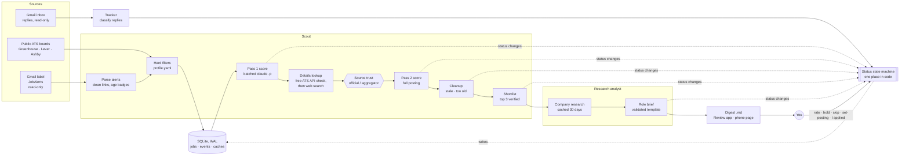
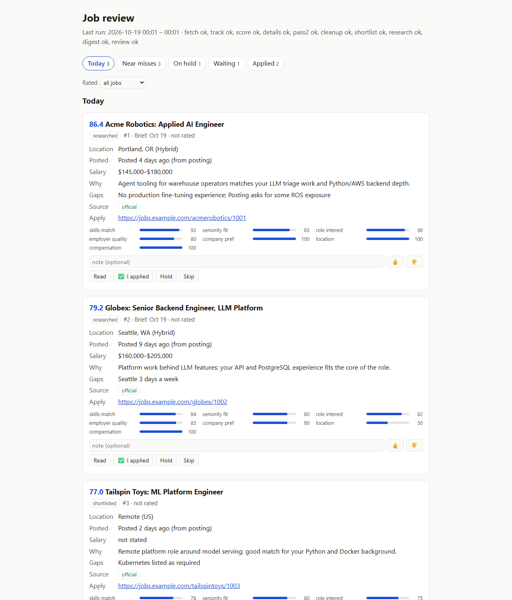

# job-agent

A local multi-agent job search assistant. Every morning it reads your job alert emails, filters and scores the postings against your profile with Claude, finds each promising job's official posting, shortlists the best three, writes a cited research brief for each, tracks replies to the applications you've sent, and leaves you a one-page digest and a local review app.

It runs on your own Windows machine with Python 3.12, SQLite and the [Claude Code](https://claude.com/claude-code) CLI in headless mode, on a consumer Claude plan rather than an API key.

**It never applies for you, never sends email and never publishes anything.** You read the digest, decide, and apply yourself.

## What it does

- **Reads job alerts, read-only.** It reads LinkedIn, Indeed and Glassdoor alert emails from one Gmail label, with the `gmail.readonly` scope only, and turns each job card into a clean job record. It can also poll the public Greenhouse, Lever and Ashby boards of companies you name.
- **Filters and scores.** Hard filters drop only postings that clearly don't fit (title, location, stated salary, posting age). Claude rates what's left against your profile, and the final score is computed in code from those ratings and your weights.
- **Finds the real posting.** For the top 15 it looks for the official posting, first through free public ATS APIs and then a web search, and labels every source as `official` or `aggregator`.
- **Rescores from the full posting.** A second pass rereads the full description and records the years required, office days, stack match, red flags and whether the posting looks closed.
- **Shortlists and researches.** It shortlists up to three verified jobs a day and writes a research brief for each: company facts with numbered citations, role fit, a skills table and questions to ask.
- **Tracks your applications.** It reads replies to jobs you've applied to (read-only), moves a job to `interviewing` on an invite, and lists what needs a follow-up.
- **Cleans up.** Shortlisted jobs you never act on, and postings too old to be worth it, are closed by the daily run and listed so you can take any back.
- **Reports.** It writes a markdown digest and a static page for your phone, and `.\run.ps1 review` opens a local app where you rate, hold, skip and research jobs.
- **Drafts LinkedIn posts (optional).** A separate Publisher agent turns public facts about your work into post drafts in Typefully, checked in code and never published.

## Architecture



Every Claude call is a stripped-down headless `claude -p` run: one prompt file plus the data, with a JSON reply that Python validates. The agents never talk to each other directly. They share the SQLite database (WAL mode, so the review app and the scheduled run can use it at the same time), and every status change goes through one transition table.

## Pipeline

`.\run.ps1 daily` runs these steps in order. A failed step is logged and shown as a warning in the digest, and the run carries on. The digest is always written. A lock file keeps two runs from overlapping, and a Windows notification says when the digest is ready.

| # | Step | Command | What happens | Claude |
|---|---|---|---|---|
| 1 | Fetch | `fetch` | Reads alert emails from the last 3 days and any polled ATS feeds, cleans links to the plain job page, reads each card's age badge, dedupes, applies hard filters, and stores new jobs as `new` | none |
| 2 | Track | `track` | Reads replies about jobs you've applied to and classifies them (confirmation, assessment, interview invite, rejection, offer, ...) | Sonnet, no tools |
| 3 | Score (pass 1) | `score` | Rates `new` jobs in batches on skills, seniority, role interest, company similarity, employer quality, staffing agency and dealbreakers. The final score is a weighted average computed in code | Sonnet, no tools |
| 4 | Details | `details` | For the top 15, tries the free public Greenhouse, Lever and Ashby APIs and cached company boards first. Only then does it make a Claude call with web search to find the official posting. LinkedIn is never fetched | Sonnet, plus Haiku for web searches |
| 5 | Pass 2 | `pass2` | Rescores the top 15 from the full posting: years required, office days, stack match, red flags, possibly closed, why, gaps | Sonnet, no tools |
| 6 | Cleanup | `posting-age` | Closes shortlisted jobs you haven't touched in 10 days, and jobs whose posting is past its age limit | none |
| 7 | Shortlist | `shortlist` | Takes the top 3 *verified* jobs (pass 2 done, `official` source, not possibly closed, not too old) at or above `shortlist_min_score`. Jobs that would have made it but aren't verified go to the digest's "Worth checking yourself" section | none |
| 8 | Research | `research` | Company step: cached research, or one web-search call with an 8-search budget. Role step: one no-tools call that writes the brief. The brief is validated and retried once with the problems listed | Sonnet |
| 9 | Digest | `digest` | Writes `digest/YYYY-MM-DD.md` and rebuilds `review/index.html` | none |

Job lifecycle:

```
new → scored → shortlisted → researched → applied → interviewing → closed
```

`applied` is set only by you: `mark-applied` on the command line, or ✅ I applied in the review app.

## The review app

`.\run.ps1 review` starts a small standard-library web server on `127.0.0.1` (a free port) and opens your browser. This screenshot is from fictional demo data:



- **Tabs with counts:** Today (shortlisted today), Near misses (scored 55 or more but below the bar, aggregator-only jobs with a "Needs official posting" badge, and official jobs you can shortlist yourself), On hold, Waiting (shortlisted earlier) and Applied (with each application's tracker timeline). A Rated filter shows the jobs you haven't rated yet.
- **Cards:** score, location, posting date and where it came from, salary, why, gaps, red flags, source trust, the apply link and sub-score bars.
- **Read panel:** the brief and the stored posting side by side. From the Posting tab you can write a brief, find the posting (the details lookup for that one job), or paste the official posting URL, which stores it, rescores the job and rewrites the brief.
- **Actions:** 👍/👎 with a note (feeds the scorer), Hold (optionally until a date; held jobs leave the shortlist and come back by themselves), Skip, Shortlist now (within the same 3-a-day limit), and ✅ I applied. Long tasks run in the background with progress on the card.
- **Safety:** it only answers requests whose `Host` is `127.0.0.1:<port>` or `localhost:<port>`, every API call needs a random per-run token, POSTs need a JSON body, and responses carry a strict Content-Security-Policy, so another website can't drive it. Every button calls the same functions as the CLI, so the state machine still checks every transition. Before it applies a database migration, it backs the database up.

The static `review/index.html` is still written for reading on your phone.

## Application tracker

`track` (also a step of `daily`) reads application email with the same read-only Gmail access:

- **It looks for mail about jobs you've applied to:** one query per applied job built from the company's own domains and known ATS senders, plus all ATS mail and recruiter-looking mail. Headers are scored first; only likely matches have their bodies fetched.
- **Claude classifies** each message in batches: category, confidence, a one-line summary, any deadline and the next action. Only the summary and category are stored, never the subject or body.
- **What it may change is limited in code:** an interview invite, assessment or scheduling email moves `applied → interviewing`, and a rejection closes the job. Anything else (an offer, low confidence, mail that isn't clearly about the job) is listed for you, never acted on. An application email for a job you haven't marked applied shows up as "Did you apply?".
- **It notices silence:** no reply for 14 days after applying suggests a follow-up; 7 quiet days while interviewing suggests a check-in.
- A Windows notification names new interview invites, rejections and offers as they arrive.

## Posting age

Old postings are rarely worth applying to, but alert emails don't carry a posting date, so every job records where its date came from and how far to trust it:

| Source | Where the date comes from | Trust |
|---|---|---|
| `ats` | The ATS's own data: a polled feed, the free board check, Workable/BambooHR/Breezy JSON | Best |
| `posting_page` | The official posting page: JSON-LD `datePosted`, published-date metadata, or the date the details lookup read there | Best |
| `alert_badge` | An alert card's "3 days ago" / "30+ days ago" (Indeed, Glassdoor), counted back from the email's date | An estimate |
| `email_date` | The alert email's own date: the posting is at least that old | Unverified |

**A better source always wins, and a worse one never replaces it.** Dates from aggregator pages are ignored.

**Limits** (in `profile.yaml`): 10 days for most jobs; 30 days for an official posting confirmed open (pass 2 doesn't doubt it); 45 days when that posting is at one of your preferred companies. A job over its limit is filtered out at fetch, refused by the shortlist, and closed by the daily cleanup with detail `posting too old: N days`. Applied and interviewing jobs are never touched, and held jobs are only flagged ("older posting, check it's still open"). The app and the digest show each job's date with its source, and a job known only by its email date is labeled "date unverified".

## Waiting cleanup

A shortlisted job you never act on shouldn't sit in "Still waiting" forever. The daily run closes `shortlisted` or `researched` jobs that were shortlisted at least `waiting_expiry_days` ago (10 by default) with no action from you since: no rating, hold, skip, posting URL or application. Held, applied and interviewing jobs are never touched. The digest lists the day's closes under "Cleaned up today", and `.\run.ps1 reopen <id> "reason"` takes one back.

## Design decisions

### Two-pass scoring

Alert emails carry a title, a company and a location, but almost never the description. Scoring everything from full postings would mean a web search per job. Instead:

- **Pass 1** scores every job cheaply from what the alert says, in batches with no tools.
- **Pass 2** runs only on the top 15, once their full official posting has been found. It sees the real requirements, so it can catch "8+ years required", a closed posting or a stack mismatch that pass 1 couldn't see.
- **Code, not Claude, computes the score.** Claude only rates the components (0–100). `compute_final()` applies your `scoring_weights`, a tier score for preferred companies, location and commute rules, salary rules, a −10 staffing-agency adjustment and a dealbreaker cap of 20. That makes scores consistent between runs and easy to retune: change a weight and run `rescore`.
- **Your ratings feed back in.** 👍/👎 (or `rate <id> up|down "note"`) adds the job to liked or disliked examples that both passes see.

### Source trust, from both links

Each found posting has two links: the page its text was read from (`source_url`) and where you'd apply (`apply_url`). The posting is labeled `official` when **either** one is official, and the official link becomes the apply link, so you're never sent to an aggregator when an official page exists. The rules for each label are in `config/source_trust.yaml`, not in code, and `retrust` reapplies them after you edit it.

| Label | Meaning | Effect |
|---|---|---|
| `official` | The company's own domain, a known ATS (Greenhouse, Lever, Ashby, Workday, Oracle Recruiting Cloud, …), or a public-sector job board | Salary, the posted date and "still open" are trusted, but only when they were read from the official page itself. A closed posting closes the job |
| `aggregator` | Anything else, LinkedIn and Indeed included | The description is used for scoring only. Salary and date stay unknown, and the link is labeled "aggregator, verify before applying" |
| `not_found` | No posting found | Retried once on a later day |

**Only `official` jobs can be shortlisted.** A job board saying a posting is closed is not taken as proof: it's treated as "check this". If you find the official page yourself, paste it in the review app (or run `set-posting <id> <url>`): it's stored, pass 2 reruns and the brief is rewritten.

### Safety rules enforced in code, not prompts

A prompt asking the model to "never apply" is a request, not a guarantee. These rules are enforced by code that a model can't talk its way past:

- **Read-only Gmail.** `agents/common/gmail.py` only ever requests `gmail.readonly`, and it refuses a stored token that carries any other scope. Scheduled runs never open a browser: an expired login becomes a warning in the digest.
- **Only you can mark a job applied.** Allowed status changes, and which actor may make each one, live in one table in `agents/db.py`. No agent actor is allowed to set `applied`, and the tracker may only move `applied → interviewing` or close with a rejection.
- **No applications and no tracking links.** Nothing fills or submits forms. Indeed's redirect tokens are decoded locally instead of followed, and LinkedIn is denied to the web-fetch tool with `--disallowedTools WebFetch(domain:…)`.
- **Untrusted HTML stays inert.** Briefs and postings are rendered by code that escapes all HTML and only links http(s) URLs.
- **Tests never reach the internet.** `tests/conftest.py` makes real HTTP and the real mailbox fail. The 850+ tests use recorded fixtures: alert emails passed through `tools/sanitize_email.py`, with companies, titles and job IDs replaced by fictional ones, and synthetic application emails.

### Cutting per-call overhead from ~30,000 to ~600 tokens

A plain `claude -p` call carries Claude Code's full system prompt, tool definitions, MCP servers, settings and slash commands. That's about 30k input tokens before your prompt even starts. At dozens of calls a day, that alone would exhaust a consumer plan. Every call strips all of it:

```
claude -p --model sonnet --output-format json
       --tools ""                                   # no tool definitions
       --system-prompt-file <our prompt>            # replaces Claude Code's system prompt
       --strict-mcp-config --mcp-config '{"mcpServers":{}}'
       --setting-sources ""                         # no user/project settings or CLAUDE.md
       --disable-slash-commands
       --no-session-persistence
```

That brings each scoring call down to about 600 tokens of overhead. Calls that need the web get exactly `WebSearch,WebFetch`, pre-approved, with a `--max-turns` cap.

Two options that look like they'd help but don't:
- **`--bare`** accepts only an API key, not a subscription login.
- **`--json-schema`** adds a tool and a second turn.

Instead, the reply is plain JSON validated in Python. Every call logs its model, tokens, cache use, web searches and cost to `logs/`, and `.\run.ps1 stats` sums them by day.

## Publisher agent (optional)

`post-ideas` and `draft-post` turn public facts about your work into LinkedIn post drafts in [Typefully](https://typefully.com). It runs by hand, never as part of `daily`, and it **only creates drafts**: you review and publish them yourself.

- **Public sources only.** Its only inputs are your resume from the Summary on (contact details stripped), this repo's README and commit subjects, and an optional notes file. The module refuses to read the database, briefs, digests or logs, and a test checks it never imports the database layer.
- **A code guard checks every post** before it's saved: 120–220 words, at most 2 hashtags and 2 emoji, no hype words, no company you prefer or are applying to, no application or recruiter phrases, no security details (IP addresses, ports, internal hostnames, tunnel IDs), none of your private terms, no email or phone number, no link or number that isn't in the sources. A post that fails is rewritten once with the problems listed, then kept local only.
- **The Typefully client can't publish.** It refuses any request carrying `publish_at` or `plan_at`, any method but GET and POST, and any POST but draft creation, before anything is sent. It also checks the free plan's monthly limit before making any Claude call.

The per-user lists (companies whose names are ordinary words, an allowlist of public phrases from your resume) are in `config/publisher.yaml`; the committed ones are fictional examples.

## Setup

**[docs/SETUP.md](docs/SETUP.md)** walks through a first install on Windows: prerequisites, Claude Code on a Claude plan, the Google Cloud and Gmail steps, job alerts, Typefully, Task Scheduler, a verify checklist and troubleshooting. **[docs/CONFIGURATION.md](docs/CONFIGURATION.md)** explains every setting, and has a Claude Code prompt that writes your profile from your resume.

In short (Windows, Python 3.12, Git, Claude Code logged in to a Claude plan):

```powershell
git clone <this repo> job-agent
cd job-agent
powershell -ExecutionPolicy Bypass -File scripts\setup.ps1          # venv, config, database, tests
# edit profile\profile.yaml and profile\preferred_companies.yaml (see docs/CONFIGURATION.md)
# save your Google OAuth client as secrets\credentials.json (see docs/SETUP.md), then:
.venv\Scripts\python.exe -m agents.common.gmail auth                 # read-only Gmail consent
.\run.ps1 daily
```

Common commands (`.\run.ps1 help` lists them all):

```powershell
.\run.ps1 daily                  # the whole morning run
.\run.ps1 review                 # the review app on 127.0.0.1
.\run.ps1 set-posting 33 <url>   # you found the official posting: store it, rescore, rewrite the brief
.\run.ps1 rate 28 up "note"      # teach the scorer
.\run.ps1 hold 28 "reason" --until 2026-11-01   # out of the shortlist until then
.\run.ps1 reopen 28 "reason"     # take back a close (skip, stale, too old)
.\run.ps1 stats --days 7         # what the agent saw and did, and Claude usage
.venv\Scripts\python.exe -m agents.db mark-applied 40 --method ats   # only you do this
```

Run the tests with `.venv\Scripts\python.exe -m pytest -q`.

## Sample digest

This sample was built from fictional jobs and companies by the real digest code. The full file is in [docs/sample-digest.md](docs/sample-digest.md); here are its first sections:

```markdown
# Job digest 2026-10-19

**Last run:** 2026-10-19 00:01 – 00:01 · fetch ok, track ok, score ok, details ok, pass2 ok, cleanup ok, shortlist ok, research ok, digest ok, review ok

## Warnings

None.

## Application updates

**New today**

- 2026-10-10 #9 **Wide World Importers**: Software Engineer II, confirmation: Application received for Software Engineer II
- 2026-10-18 #9 **Wide World Importers**: Software Engineer II, interview invite: Invitation to a 30-minute recruiter screen (next: Pick a time by Friday) → now **interviewing**

**Consider a follow-up**

- #10 **Adventure Works**: Data Platform Engineer, no reply for 16 days

## Today's top 3

### 1. Acme Robotics: Applied AI Engineer (86.4)

- **Location:** Portland, OR (Hybrid)
- **Posted:** Posted 4 days ago (from posting)
- **Salary:** $145,000–$180,000
- **Why:** Agent tooling for warehouse operators matches your LLM triage work and Python/AWS backend depth.
- **Gaps:** No production fine-tuning experience; Posting asks for some ROS exposure
- **Apply:** https://jobs.example.com/acmerobotics/1001
- **Source:** official
- **Brief:** [Read brief](../briefs/2026-10-19-acme-robotics-applied-ai-engineer.md)
- **Sub-scores:** skills 92 · seniority 85 · role 90 · employer 80 · company 100 · location 100 · comp 100 (pass 2)
- Job #1. `.\run.ps1 rate 1 up` / `down`, `.\run.ps1 skip 1 "reason"`

### 2. Globex: Senior Backend Engineer, LLM Platform (79.2)
...

## Worth checking yourself

These would have made the top 3, but no open official posting is confirmed, so they weren't shortlisted.

- #4 81.0 **Fabrikam**: AI Engineer (Remote (US)), found only on aggregator — run set-posting if you find the official page; aggregator posting: https://www.builtin.com/job/ai-engineer/4. Posted ~3 days ago (alert). Alert link: https://www.linkedin.com/jobs/view/5000000004/

## Still waiting

- #7 **Contoso Logistics**: Backend Engineer, Routing (74.1), waiting 2 days, researched. Posted 6 days ago (from posting). https://jobs.example.com/contosologistics/1005

On hold, with a posting past the age limit (held jobs are never closed):

- #8 **Northwind Traders**: Forward Deployed Engineer (72.5), Posted 34 days ago (from posting) — older posting, check it's still open

## Cleaned up today

Closed today: shortlisted jobs with no action from you (no rating, hold, skip or apply), and postings too old (limit 10 days; 30 for a confirmed open official posting, 45 at a preferred company). Take one back with `.\run.ps1 reopen <id> "reason"`.

- #11 **Proseware**: Backend Engineer, AI Search (66.4), stale: no action 10 days
- #12 **Lucerne Publishing**: AI Engineer (64.0), posting too old: 14 days
...
```

## Project layout

| Path | Purpose |
|---|---|
| `run.ps1` | Entry point for every command, one dispatch table |
| `agents/scout/` | Fetch, alert parsers, filters, scoring passes, details lookup, ATS APIs, source trust, posting age, cleanup, shortlist |
| `agents/research/` | Research briefs |
| `agents/tracker/` | Application tracker: matching, classification, follow-up report |
| `agents/publisher/` | LinkedIn post drafts: sources, guard, Typefully client |
| `agents/review_app.py` | The local review app; `agents/review.py` writes the static phone page |
| `agents/daily.py` | The morning run, with its lock, run history and notification |
| `agents/common/` | Claude CLI runner, Gmail (read-only), markdown-to-HTML, logs, toasts |
| `agents/db.py` | SQLite schema migrations, backups and the status state machine |
| `prompts/` | The instructions for each Claude call, including the brief template |
| `config/source_trust.yaml` | Official ATS, public-sector and company domains, domains never fetched, ATS sender domains |
| `config/publisher.yaml` | The Publisher guard's lists (fictional examples for the per-user ones) |
| `profile/*.example.yaml` | Example profile and preferred companies (fictional) |
| `tools/sanitize_email.py` | Turns a real alert email into a redacted test fixture |
| `docs/` | Setup guide, configuration reference, and the sample digest and screenshot (fictional data) |
| `tests/` | pytest suite with sanitized and synthetic fixtures; no network |
| `CLAUDE.md` | Detailed design notes and rules for working on the code with Claude Code |

## License

[MIT](LICENSE)
